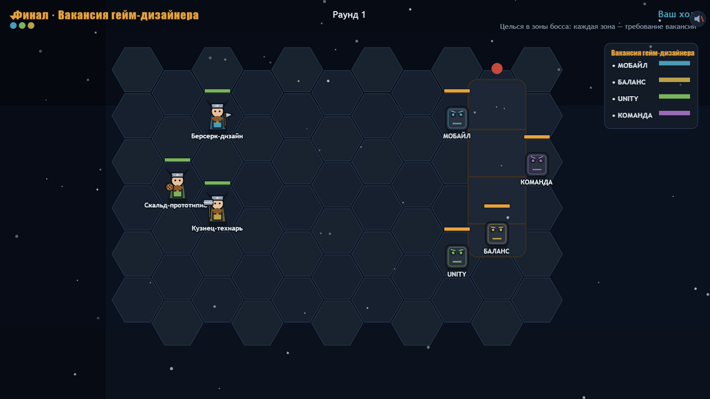
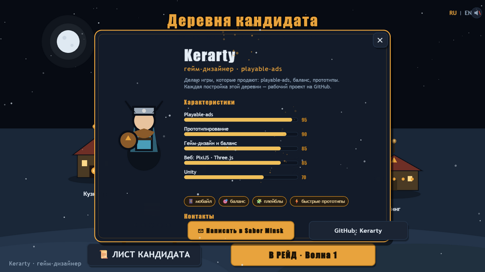

# I, Кандидат — тактическое резюме для Saber Minsk

Интерактивное резюме-игра под вакансию в Saber Minsk: пошаговая тактика на гексах,
в которой каждая способность — реальный проект из моего портфолио, а урон
измеряется фактами. Босс — сама вакансия гейм-дизайнера: пробиваешь зоны
«Мобайл / Баланс / Unity / Команда» и подписываешь оффер.



## Зачем

Обычное резюме HR читает 30 секунд и закрывает. Это резюме они проходят сами:
волна за волной открываются разделы портфолио, и к экрану победы кандидат уже
«принят в отряд». Форма отвечает содержанию — я делаю playable-ads, поэтому
и резюме собрано по их канонам: один HTML-файл, ~900 КБ, ноль сетевых запросов,
работает офлайн и с file://.

Сеттинг не случайный: I, Viking — собственная игра Saber Minsk, Gloomhaven
и Phoenix Point — их порты. Механики цитируют именно их игры:

- **Echo Loop** повторяет последнюю карту — это механика моей головоломки
  [echoloop-playble](https://github.com/Kerarty/echoloop-playble) на Unity 6 + URP;
- **free-aim** по зонам босса — отсылка к Phoenix Point;
- карты способностей стилизованы под Гвинт (The Witcher 3 — ко-дев Saber).

## Что внутри

- 3 волны: стая багов → кринч с дедлайнами → босс «Вакансия гейм-дизайнера»
- отряд из трёх героев: Берсерк-дизайн, Скальд-прототипист, Кузнец-технарь
- 9 карт способностей, каждая подписана фактом из портфолио
- деревня-хаб: постройки = разделы резюме, факты — карточками в гвинт-стиле
- «Лист кандидата»: аватар, характеристики с анимированными полосами, контакты
- экран победы с отчётом рейда и кнопкой письма в Saber Minsk
- RU/EN, тач-управление, процедурная графика и звук (WebAudio)



## Запуск

Игра — один файл, зависимостей нет:

```bash
# открыть index.html двойным кликом — уже работает
# или поднять локальный сервер:
python -m http.server 8000
# → http://localhost:8000
```

Сборка из исходников (нужен Node.js):

```bash
node build.js   # инлайнит src/ + PixiJS в index.html
```

## Технологии

- PixiJS 8 — рендер (инлайн в HTML, без CDN)
- чистый JavaScript, без сборщиков и фреймворков
- WebAudio — процедурный звук
- Canvas-арт рисуется кодом: ни одного внешнего ассета

## Структура

```
index.html            — собранная игра (главный артефакт)
build.js              — сборка одностраничника из src/
src/                  — исходники: сцены, данные, i18n, эффекты
GDD.md                — гейм-дизайн-документ с балансом
```

## Планы

- второй язык персонажей в бою (реплики героев)
- счётчик скорости прохождения: «рейд за N минут»
- адаптация под вертикальный мобильный экран

---

Автор: [Kerarty](https://github.com/Kerarty) · гейм-дизайнер · Минск
