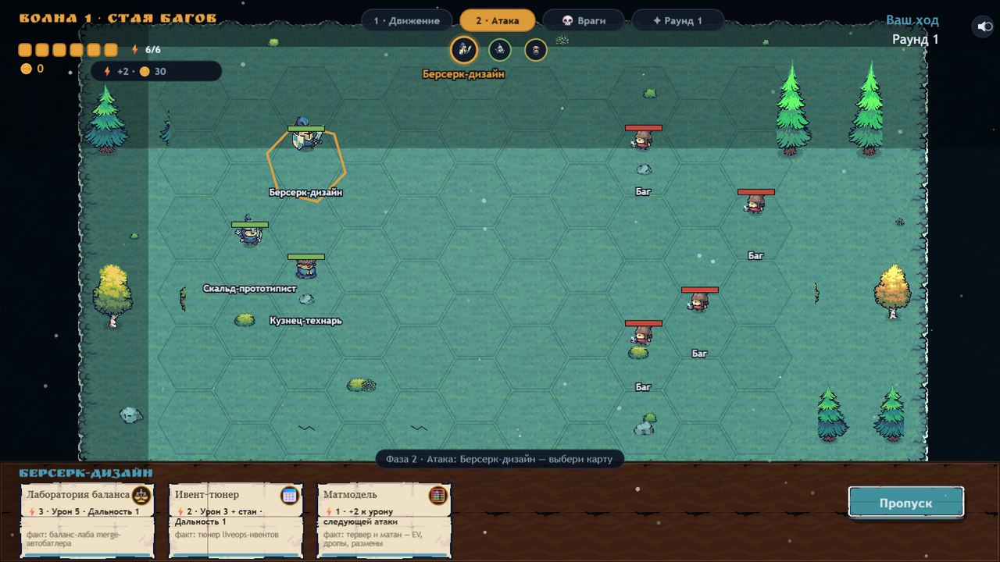
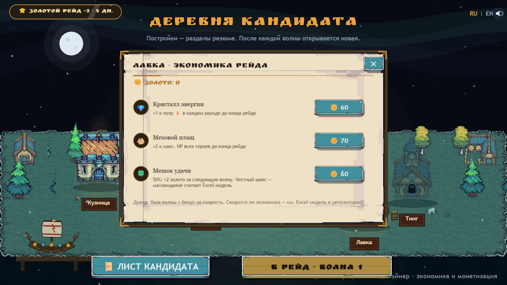

# Я, Кандидат — тактическое резюме: баланс и экономика F2P

**Играть: [kerarty.github.io/cv-saber](https://kerarty.github.io/cv-saber/)** ·
нет времени играть — жмите «Сразу к резюме» прямо на титуле.

Интерактивное резюме-игра под вакансию гейм-дизайнера F2P (баланс, экономика,
монетизация): пошаговая тактика на гексах, в которой каждая способность —
реальный проект из моего портфолио, а урон измеряется фактами. Босс — сама
вакансия: пробиваешь зоны «Баланс / Экономика / Аналитика / Монетизация»
и подписываешь оффер.


## Зачем

Обычное резюме HR читает 30 секунд и закрывает. Это резюме они проходят сами:
волна за волной открываются разделы портфолио, и к экрану победы кандидат уже
«принят в отряд». Форма отвечает содержанию — я делаю playable-ads, поэтому
и резюме собрано по их канонам: один HTML-файл ~1.7 МБ, ноль сетевых запросов
в рантайме, работает офлайн и с file://.

Вакансия — экономика и монетизация F2P, поэтому резюме не рассказывает про
экономику, а **показывает её в бою**: энергия карт, золото за волны, лавка
с покупками, liveops-ивент — и вся математика открыта в Excel-модели.

Сеттинг не привязан к студии, а механики цитируют проверенные тактики:

- **Echo Loop** повторяет последнюю карту — это механика моей головоломки
  [echoloop-playble](https://github.com/Kerarty/echoloop-playble) на Unity 6 + URP;
- **free-aim** по зонам босса — отсылка к Phoenix Point;
- карты способностей стилизованы под Гвинт (The Witcher 3 — ко-дев Saber).

## Что внутри

- 3 волны: стая багов → кринч с дедлайнами → босс «Вакансия: гейм-дизайнер F2P»
- ход в две фазы, как в XCOM: движение всего отряда → атака картами
- **энергия карт**: пул ⚡6 на раунд, у каждой карты цена — ресурсное решение в бою
- **экономика рейда**: золото за волны (база + бонус за скорость), лавка
  (кристалл энергии, меховой плащ, мешок удачи с честным EV), докупка
  энергии за золото прямо в бою
- **liveops-ивент «Золотой рейд»**: ×2 золото, лента с таймером до
  воскресенья с автопродлением, «Ивент-центр» с разбором чужого ивента
- очередь хода с портретами, подсветка хода и целей, спрайтовые взрывы
- отряд из трёх героев: Берсерк-дизайн, Скальд-прототипист, Кузнец-технарь
- 9 карт способностей, каждая подписана фактом из портфолио
- деревня-хаб на травяном острове: постройки = разделы резюме, факты —
  гвинт-картами на пергаменте
- «Лист кандидата»: медальон-виньетка с героем, характеристики с анимированными
  полосами, «Скачать PDF» и «Пропустить — всё резюме сразу»
- экран победы с отчётом рейда, **экономикой (заработано/потрачено)**,
  золотым снегом и кнопкой письма кандидату
- **[economy_model.xlsx](economy_model.xlsx)** — модель баланса и экономики
  с живыми формулами: TTK, faucet/sink, EV удачи, разбор ивента, Review-проверки
- RU / EN, тач-управление, процедурный звук (WebAudio)


## Визуал

Бой и деревня стоят на тайлах Tiny Swords: травяной остров в ночном фьорде,
тайловая вода с дрейфом, деревья и кусты по кромке поля. Интерфейс сшит из того
же пака: кнопки-девять-слайсы (золотые и синие с металлической кромкой),
пергаментные панели в гвинт-стиле с деревянной рамой и золотыми уголками,
карточки фактов — гвинт-карты на пергаменте. Кодом поверх нарисованы драккар,
аватар-виньетка (герой на ночной поляне под луной), босс-тотем, снег и северное
сияние.





## Запуск

Игра — один файл, зависимостей нет:

```bash
# открыть index.html двойным кликом — уже работает
# или поднять локальный сервер:
python -m http.server 8000
# → http://localhost:8000
```

Сборка из исходников (нужен Node.js):

```bash
node build.js   # инлайнит src/ + PixiJS + атласы в index.html
```

## Технологии

- PixiJS 8 — рендер (инлайн в HTML, без CDN)
- чистый JavaScript, без сборщиков и фреймворков
- WebAudio — процедурный звук
- арт-пак [Tiny Swords](https://pixelfrog-assets.itch.io/tiny-swords) от Pixel Frog (free license):
  юниты, здания, тайлы острова и воды, UI-кнопки и пергамент — вшиты base64
- шрифты Ruslan Display и Yeseva One (SIL OFL) — base64
- остальное рисуется кодом: драккар, аватар-виньетка, босс-тотем, эффекты,
  снег, северное сияние

## Структура

```
index.html            — собранная игра (главный артефакт)
build.js              — сборка одностраничника из src/
src/                  — исходники: сцены, данные, i18n, эффекты
economy_model.xlsx    — модель баланса и экономики (живые формулы)
assets/               — скриншоты для README
GDD.md                — гейм-дизайн-документ v2.0 (баланс, экономика, ивент)
```

## Планы

- реплики героев в бою на двух языках
- счётчик скорости: «рейд за N минут»
- адаптация под вертикальный мобильный экран

---

Автор: [Kerarty](https://github.com/Kerarty) · гейм-дизайнер · Минск ·
резюме-игры: [12+ под разные студии](https://github.com/Kerarty?tab=repositories)
